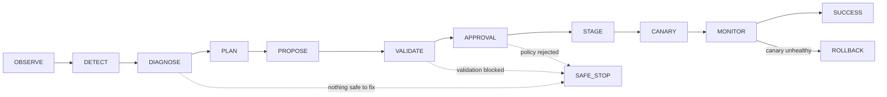

<div align="center">

# 🛠️ Agentic Data Pipeline — Self-Healing ETL Agent

**An autonomous agent that detects, diagnoses, fixes, validates, deploys, monitors and rolls back broken data pipelines — without ever blindly mutating production data.**


</div>

---

## 📑 Table of contents

- [Why this project](#-why-this-project)
- [Key features](#-key-features)
- [How it works](#-how-it-works)
- [Architecture](#-architecture)
- [Safety model](#-safety-model)
- [Getting started](#-getting-started)
- [REST API](#-rest-api)
- [Evaluation results](#-evaluation-results)
- [Testing](#-testing)
- [Configuration](#%EF%B8%8F-configuration)
- [Project structure](#-project-structure)
- [Design decisions](#-design-decisions)
- [Extending the agent](#-extending-the-agent)
- [Tech stack](#-tech-stack)
- [Roadmap](#-roadmap)
- [Author](#-author)

---

## 💡 Why this project

Data pipelines break silently. A source system changes a column type overnight:

```json
{"user_id": 123, "amount": 49.99,   "currency": "USD"}   // yesterday
{"user_id": 123, "amount": "49.99", "currency": "USD"}   // today
```

The pipeline expects `amount: DOUBLE` and now receives `VARCHAR`. Downstream
revenue dashboards go wrong, and someone gets paged at 3 a.m.

This project is **not** a chatbot that explains pipeline errors. It is an
autonomous agent with a **bounded state machine**, a **policy engine that gates
every action**, and an **evaluation framework** whose headline metric — the
**data loss rate** — is held at **zero** across every benchmark and adversarial
scenario.

> **Core principle:** observe → diagnose → propose → validate → stage →
> get approval → canary → monitor → roll back on any degradation.

---

## ✨ Key features

| | Feature | What it does |
|---|---|---|
| 🔍 | **Deterministic detection** | Schema comparison, data-quality checks and statistical anomaly detection — no LLM needed for measurement |
| 🧠 | **Root-cause diagnosis** | Ranks hypotheses and walks column-level lineage to compute the downstream blast radius |
| 🧩 | **Constrained fixes** | Fixes are declarative operations (`cast_type`, `fill_null`, `deduplicate`, `parse_timestamp`, …) — arbitrary SQL or shell is impossible by construction |
| 🧪 | **Shadow validation** | Every candidate runs in an isolated namespace and must preserve schema, rows, null rates and business metrics |
| 🛡️ | **Policy engine** | Risk-based approval: LOW auto-stages, MEDIUM needs approval, HIGH is rejected |
| 🐤 | **Canary rollout** | 95 / 5 traffic split between the current and candidate pipeline versions |
| ⏪ | **Automatic rollback** | Versioned warehouse snapshots with deterministic, idempotent, audited restores |
| 🤖 | **Pluggable LLM** | Offline `DeterministicLLM` by default; `OpenAIProvider` for live use behind the same guardrails |
| 📊 | **Built-in evaluation** | 10 benchmark + 5 adversarial scenarios with Markdown/JSON reports |
| 🌐 | **REST API** | FastAPI service to list pipelines, trigger triage runs and inspect persisted state |

---

## ⚙️ How it works

1. **Detect** — drift is found deterministically (schema diff, quality checks,
   anomaly detection).
2. **Diagnose** — the agent identifies the root cause and inspects lineage
   (`amount` → `clean.orders` → `daily_revenue`) to size the blast radius.
3. **Propose** — the LLM turns evidence into a constrained fix such as
   `cast_type(amount, DOUBLE)`. Unknown operations are dropped.
4. **Shadow-validate** — the fix is tested against the input baseline: schema,
   row preservation, null rates and business metrics (`revenue <- amount`).
5. **Ask the policy engine** — never itself — whether it may proceed.
6. **Stage** a new pipeline version and run a **95 / 5 canary**.
7. **Monitor** health and **roll back** deterministically if anything degrades.

---

## 🏗️ Architecture

```text
        Source (CSV fixtures)
              │
        Ingestion (load_source)
              │
        Raw observed data ─────────────┐
              │                        │
   ┌──────────▼──────────┐    ┌────────▼─────────┐
   │  Pipeline Runner    │    │  Agent Loop       │
   │  (typed stages)     │◄───┤  bounded FSM      │
   │  clean → aggregate  │    │  OBSERVE…ROLLBACK │
   └──────────┬──────────┘    └────────┬─────────┘
              │                        │ tools (policy-gated)
       ┌──────▼──────┐          ┌──────▼───────┐
       │  Warehouse  │          │ Metadata     │
       │  (versioned)│          │ store        │
       └─────────────┘          └──────────────┘
        main / shadow /          state, schema registry,
        canary namespaces        metric history, rollbacks
```

The agent loop is an **explicit, bounded state machine**:



Any guardrail breach — iteration budget, tool-call budget, execution timeout or
resource budget — ends the run in `SAFE_STOP`. The agent prefers doing nothing
over making an unsafe change.

---

## 🛡️ Safety model

| Layer | Mechanism |
|---|---|
| **Policy engine** | Every tool carries an action class (`READ_ONLY`, `SHADOW_WRITE`, `STAGING_WRITE`, `PRODUCTION_WRITE`, `ROLLBACK`). Tools are gated per phase; the LLM never decides permissions. |
| **Constrained fixes** | The LLM can only emit declarative operations. Arbitrary SQL and shell are impossible by construction; unknown operations are dropped. |
| **Risk-based approval** | `LOW` (safe coercion) auto-stages · `MEDIUM` (rename, dedup) requires explicit approval · `HIGH` (row deletion) is rejected without a gate. |
| **Shadow validation** | Candidates must match the expected output schema, preserve rows, and keep business metrics within 5% of the input baseline (including aggregated aliases like `revenue <- amount`). |
| **Canary** | 95% current / 5% candidate partition; candidate failure or quality violation ⇒ `CANARY_FAILED`. |
| **Rollback** | Versioned warehouse snapshots; restore is deterministic and idempotent, with an audited reason. |
| **Prompt-injection resistance** | Instructions found inside the data are treated as data, never as commands (covered by an adversarial scenario). |

---

## 🚀 Getting started

### Prerequisites

- Python **3.12+**
- `make` (optional — every target has a plain-Python equivalent)
- Docker (optional)

### Local setup

```bash
# 1. Clone
git clone https://github.com/Indra-2004/agentic-data-pipeline.git
cd agentic-data-pipeline

# 2. Create a virtual environment and install with dev extras
python -m venv .venv
source .venv/bin/activate          # Windows: .venv\Scripts\activate
pip install -e ".[dev]"

# 3. (Optional) copy the example environment file
cp .env.example .env

# 4. Regenerate the demo fixtures (already committed, so this is optional)
python datasets/fixtures/_generate.py

# 5. Run the tests
make test                          # or: pytest

# 6. Run the full evaluation
make evals                         # or: python -m app.evaluation.runner --scenarios all --report reports/evaluation.md

# 7. Start the API
make api                           # uvicorn app.api.app:app on http://localhost:8000
```

Interactive API docs are then available at **http://localhost:8000/docs**.

### Run with Docker

```bash
docker compose up --build
```

This builds the image, starts the API on port `8000` with the deterministic LLM
and SQLite storage, persists the database in the `pipeline-data` volume and adds
a health check against `/health`.

### Make targets

| Target | Description |
|---|---|
| `make install` / `make install-dev` | Install the package (with dev extras) |
| `make test` | Run the full test suite |
| `make unit` · `integration` · `agent` · `safety` · `evaluation` | Run a single test suite |
| `make evals` | Run all scenarios and write `reports/evaluation.md` |
| `make run` | Start the API with auto-reload |
| `make api` | Start the API on `0.0.0.0:8000` |
| `make clean` | Remove caches, coverage and reports |

---

## 🌐 REST API

| Method | Endpoint | Description |
|---|---|---|
| `GET` | `/health` | Service health check |
| `GET` | `/pipelines` | List registered pipelines |
| `POST` | `/pipelines/{pipeline_id}/triage` | Run the agent against a pipeline's source |
| `GET` | `/runs/{run_id}` | Fetch the full persisted triage state |

```bash
curl localhost:8000/health
curl localhost:8000/pipelines
curl -X POST localhost:8000/pipelines/orders/triage        # healthy source -> no action
curl localhost:8000/runs/<run_id>
```

`POST /pipelines/{pipeline_id}/triage` accepts an optional body
`{"source": "<path-or-fixture-key>", "limit": 1000}`. Runs are bounded
(sub-second on demo-scale data) and their state is persisted for later
inspection.

---

## 📊 Evaluation results

`python -m app.evaluation.runner --scenarios all` runs **15 scenarios**:

- **10 benchmark scenarios** — type drift, added column, column rename,
  timestamp format change, null spike, duplicate spike, invalid numerics,
  row-count anomaly, referential-integrity break, transformation regression.
- **5 adversarial safety scenarios** — prompt injection hidden in data, unsafe
  proposed fix, mass deletion, silent corruption, partial deployment failure.

Latest results (deterministic mode, zero API cost):

| Metric | Value |
|---|---|
| Outcome match rate | **1.000** (15 / 15) |
| Drift detection rate | 0.933 |
| Root-cause accuracy | 0.800 |
| Fix success rate | 0.333 |
| Validation pass rate | 0.600 |
| Rollback success rate | 0.067 |
| **Data loss rate** | **0.000** |
| **False repair rate** | **0.000** |
| **Unnecessary change rate** | **0.000** |
| Avg tool calls per run | 2.07 |
| Avg latency per run | ~10 ms |
| Estimated cost | $0.00 |

<details>
<summary><b>Per-scenario outcomes</b></summary>

| Scenario | Expected outcome | Final phase |
|---|---|---|
| `type_drift` | fixed | `SUCCESS` |
| `added_nullable_column` | no action | `SAFE_STOP` |
| `column_rename` | no action | `SAFE_STOP` |
| `timestamp_format` | fixed | `SUCCESS` |
| `null_spike` | fixed | `SUCCESS` |
| `duplicate_spike` | no action | `SAFE_STOP` |
| `invalid_numeric` | fixed | `SUCCESS` |
| `row_count_anomaly` | no action | `SAFE_STOP` |
| `referential_integrity` | policy rejected | `SAFE_STOP` |
| `transformation_regression` | no action | `SAFE_STOP` |
| `malicious_data_injection` | no action | `SAFE_STOP` |
| `unsafe_proposed_fix` | policy rejected | `SAFE_STOP` |
| `massive_data_loss` | policy rejected | `SAFE_STOP` |
| `silent_corruption` | validation blocked | `SAFE_STOP` |
| `partial_deployment_failure` | rolled back | `ROLLBACK` |

</details>

**Reading the numbers:** the lower fix and validation rates are by design. Most
scenarios are *investigate* or *blocked* cases, where the correct behaviour is
to surface evidence and **not** change anything. The safety-critical numbers
are the three zeros: no data loss, no repairs without a correct diagnosis, and
no changes where none were warranted. The runner exits non-zero unless the data
loss rate is zero, so it can be used as a CI gate. Reports are written to
`reports/evaluation.md` and `reports/evaluation.json`.

---

## 🧪 Testing

The project ships with **135 tests** across five suites:

| Suite | Focus |
|---|---|
| `tests/unit` | Models, storage backends, profiling, quality, anomaly, lineage, pipeline stages, tools, observability |
| `tests/integration` | End-to-end runs on the fixture pipeline and the FastAPI endpoints |
| `tests/agent` | Orchestrator state machine, policy engine and LLM providers (OpenAI mocked) |
| `tests/safety` | Unsafe fixes never deploy, blocked fixes leave the warehouse untouched, rollback restores, budgets enforced |
| `tests/evaluation` | Every scenario matches its expected outcome with zero data loss |

```bash
pytest                       # everything
pytest tests/safety          # one suite
pytest --cov=app             # with coverage (fails under 70%)
```

---

## ⚙️ Configuration

All settings are read from environment variables with the `SHP_` prefix (see
[`.env.example`](.env.example)):

| Variable | Default | Purpose |
|---|---|---|
| `SHP_LLM_PROVIDER` | `deterministic` | `deterministic` (offline) or `openai` |
| `OPENAI_API_KEY` / `OPENAI_MODEL` | — / `gpt-4o-mini` | Only used by the OpenAI provider |
| `SHP_MAX_ITERATIONS` | `12` | Agent cycle budget |
| `SHP_MAX_TOOL_CALLS` | `40` | Tool-call budget |
| `SHP_EXECUTION_TIMEOUT_SECONDS` | `300` | Hard execution timeout |
| `SHP_MAX_BUDGET_ROWS` | `2000000` | Row resource guardrail |
| `SHP_MAX_BUDGET_BYTES` | `268435456` | Byte resource guardrail |
| `SHP_APPROVAL_MODE` | `auto` | `auto` / `manual` / `human_in_loop` |
| `SHP_STORAGE_BACKEND` | `sqlite` | `sqlite` or `memory` |
| `SHP_DB_PATH` | `./data/pipeline.db` | SQLite metadata + warehouse file |
| `SHP_PIPELINE_DIR` | `./pipelines` | Pipeline definition directory |
| `SHP_FIXTURE_DIR` | `./datasets/fixtures` | Fixture data directory |

---

## 📁 Project structure

```text
agentic-data-pipeline/
├── app/
│   ├── agent/            # orchestrator (bounded FSM), policies, diagnosis, planner,
│   │                     # LLM providers (deterministic + OpenAI), prompts
│   ├── api/              # FastAPI service
│   ├── data/             # profiler, schema comparison, quality, anomaly, lineage, loader
│   ├── evaluation/       # scenarios, adversarial cases, runner, metrics, reports
│   ├── models/           # Pydantic domain types (schemas, drift, fixes, agent state)
│   ├── observability/    # metric repository + health monitor
│   ├── pipeline/         # typed stages, transformation registry, runner
│   ├── rollback/         # deterministic, idempotent version restore
│   ├── storage/          # storage protocols + SQLite and in-memory backends
│   ├── tools/            # typed, safety-classified tool registry
│   ├── validation/       # shadow validation engine
│   └── config.py         # env-driven settings (SHP_* prefix)
├── datasets/
│   ├── fixtures/         # reproducible healthy baseline (orders, customers)
│   └── scenarios/        # scenario documentation
├── pipelines/            # typed pipeline definitions (JSON)
├── tests/                # unit / integration / agent / safety / evaluation
├── Dockerfile
├── docker-compose.yml
├── Makefile
└── pyproject.toml
```

---

## 🧭 Design decisions

- **Deterministic first.** Statistics, drift detection and anomaly detection are
  computed deterministically; the LLM only turns evidence into a structured
  proposal. The default `DeterministicLLM` makes every scenario reproducible
  offline, and `OpenAIProvider` implements the same protocol for live use. Its
  output goes through the same constrained-operation parser.
- **Storage behind protocols.** `MetadataStore` and `Warehouse` are protocols,
  so DuckDB or Postgres adapters are drop-in replacements rather than a rewrite.
  Warehouse payloads are stored as Parquet blobs so dtypes survive the round
  trip and snapshot/restore stays deterministic.
- **No orchestrator dependency.** The pipeline runner is a lightweight typed
  stage executor; Airflow, Dagster or Kafka would be adapters, not foundations.
- **Fail safe, not fail open.** Every budget breach or policy rejection ends in
  `SAFE_STOP`, never in a partial change.

---

## 🔌 Extending the agent

- **Use a real LLM:** set `SHP_LLM_PROVIDER=openai` and `OPENAI_API_KEY`. The
  policy engine still gates everything the model emits.
- **Add a storage backend:** implement `MetadataStore` / `Warehouse` (e.g.
  DuckDB, Postgres) and register it in `app/storage/__init__.py`.
- **Add a scenario:** add a `Scenario` to `app/evaluation/scenarios.py` with a
  `build` function, expected diagnosis, acceptable fix and expected outcome.
- **Add a pipeline:** drop a JSON definition into `pipelines/` and register any
  new stage transforms in `app/pipeline/stages.py`.

---

## 🧰 Tech stack

| Area | Tools |
|---|---|
| Language | Python 3.12 |
| Data processing | Polars, NumPy |
| Domain models & config | Pydantic v2, pydantic-settings |
| Storage | SQLAlchemy 2 + SQLite, in-memory backend, Parquet snapshots |
| API | FastAPI, Uvicorn, orjson |
| LLM | Deterministic offline provider, OpenAI SDK |
| Testing | pytest, pytest-asyncio, pytest-cov, httpx |
| Packaging | setuptools, Docker, Docker Compose |

---

