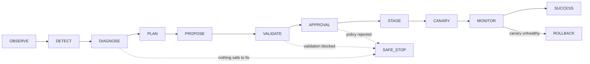

<div align="center">

# 🛠️ Agentic Data Pipeline — Self-Healing ETL Agent

**An autonomous agent that detects, diagnoses, fixes, validates, deploys, monitors and rolls back broken data pipelines — without ever blindly mutating production data.**


</div>

---

## 📑 Table of contents

- [Why this project](#-why-this-project)
- [Key features](#-key-features)
- [How it works](#-how-it-works)
- [Architecture](#-architecture)
- [Safety model](#-safety-model)
- [Getting started](#-getting-started)
- [REST API](#-rest-api)
- [Evaluation results](#-evaluation-results)
- [Testing](#-testing)
- [Configuration](#%EF%B8%8F-configuration)
- [Project structure](#-project-structure)
- [Design decisions](#-design-decisions)
- [Extending the agent](#-extending-the-agent)
- [Tech stack](#-tech-stack)
- [Roadmap](#-roadmap)
- [Author](#-author)

---

## 💡 Why this project

Data pipelines break silently. A source system changes a column type overnight:

```json
{"user_id": 123, "amount": 49.99,   "currency": "USD"}   // yesterday
{"user_id": 123, "amount": "49.99", "currency": "USD"}   // today
```

The pipeline expects `amount: DOUBLE` and now receives `VARCHAR`. Downstream
revenue dashboards go wrong, and someone gets paged at 3 a.m.

This project is **not** a chatbot that explains pipeline errors. It is an
autonomous agent with a **bounded state machine**, a **policy engine that gates
every action**, and an **evaluation framework** whose headline metric — the
**data loss rate** — is held at **zero** across every benchmark and adversarial
scenario.

> **Core principle:** observe → diagnose → propose → validate → stage →
> get approval → canary → monitor → roll back on any degradation.

---

## ✨ Key features

| | Feature | What it does |
|---|---|---|
| 🔍 | **Deterministic detection** | Schema comparison, data-quality checks and statistical anomaly detection — no LLM needed for measurement |
| 🧠 | **Root-cause diagnosis** | Ranks hypotheses and walks column-level lineage to compute the downstream blast radius |
| 🧩 | **Constrained fixes** | Fixes are declarative operations (`cast_type`, `fill_null`, `deduplicate`, `parse_timestamp`, …) — arbitrary SQL or shell is impossible by construction |
| 🧪 | **Shadow validation** | Every candidate runs in an isolated namespace and must preserve schema, rows, null rates and business metrics |
| 🛡️ | **Policy engine** | Risk-based approval: LOW auto-stages, MEDIUM needs approval, HIGH is rejected |
| 🐤 | **Canary rollout** | 95 / 5 traffic split between the current and candidate pipeline versions |
| ⏪ | **Automatic rollback** | Versioned warehouse snapshots with deterministic, idempotent, audited restores |
| 🤖 | **Pluggable LLM** | Offline `DeterministicLLM` by default; `OpenAIProvider` for live use behind the same guardrails |
| 📊 | **Built-in evaluation** | 10 benchmark + 5 adversarial scenarios with Markdown/JSON reports |
| 🌐 | **REST API** | FastAPI service to list pipelines, trigger triage runs and inspect persisted state |

---

## ⚙️ How it works

1. **Detect** — drift is found deterministically (schema diff, quality checks,
   anomaly detection).
2. **Diagnose** — the agent identifies the root cause and inspects lineage
   (`amount` → `clean.orders` → `daily_revenue`) to size the blast radius.
3. **Propose** — the LLM turns evidence into a constrained fix such as
   `cast_type(amount, DOUBLE)`. Unknown operations are dropped.
4. **Shadow-validate** — the fix is tested against the input baseline: schema,
   row preservation, null rates and business metrics (`revenue <- amount`).
5. **Ask the policy engine** — never itself — whether it may proceed.
6. **Stage** a new pipeline version and run a **95 / 5 canary**.
7. **Monitor** health and **roll back** deterministically if anything degrades.

---

## 🏗️ Architecture

```text
        Source (CSV fixtures)
              │
        Ingestion (load_source)
              │
        Raw observed data ─────────────┐
              │                        │
   ┌──────────▼──────────┐    ┌────────▼─────────┐
   │  Pipeline Runner    │    │  Agent Loop       │
   │  (typed stages)     │◄───┤  bounded FSM      │
   │  clean → aggregate  │    │  OBSERVE…ROLLBACK │
   └──────────┬──────────┘    └────────┬─────────┘
              │                        │ tools (policy-gated)
       ┌──────▼──────┐          ┌──────▼───────┐
       │  Warehouse  │          │ Metadata     │
       │  (versioned)│          │ store        │
       └─────────────┘          └──────────────┘
        main / shadow /          state, schema registry,
        canary namespaces        metric history, rollbacks
```

The agent loop is an **explicit, bounded state machine**:



Any guardrail breach — iteration budget, tool-call budget, execution timeout or
resource budget — ends the run in `SAFE_STOP`. The agent prefers doing nothing
over making an unsafe change.

---

